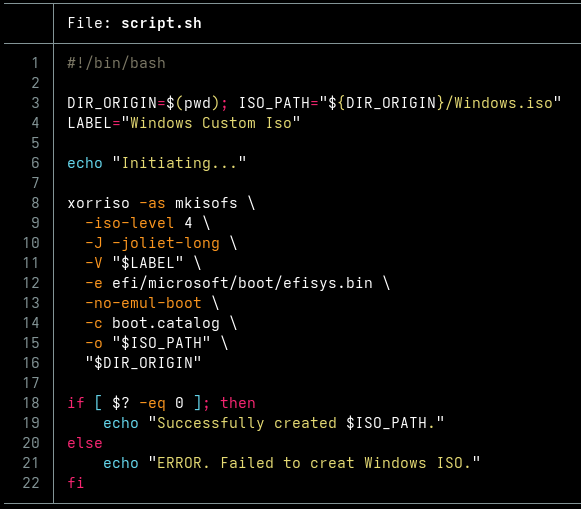

### Windows 11 iso creation

This is a very simple script that recreates a Windows ISO, in case you want to modify it (for example, to insert a autounattend.xml file).

You just need xorriso to run it. In nix, you can run:

    nix-shell -p xorriso

